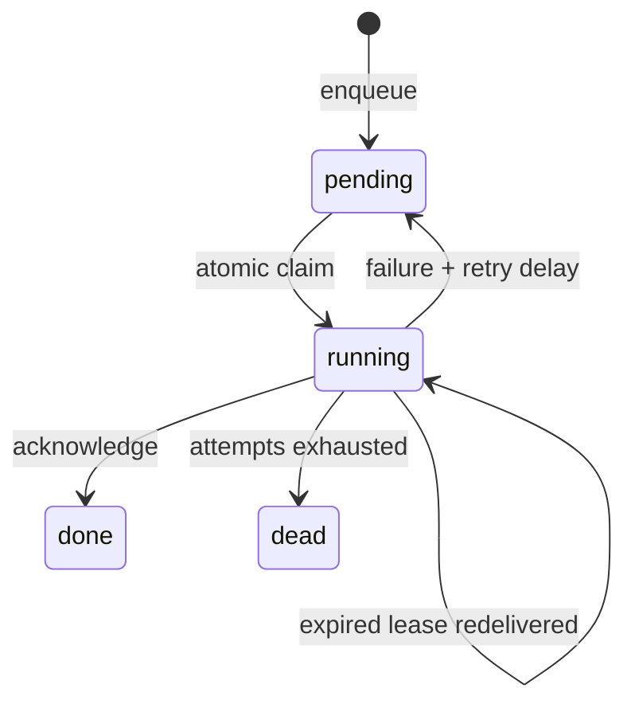

# QueuePilot

**A durable job runner that treats failure as a normal event.**

Queues look simple until a worker crashes after claiming a task, a retry doubles an external side effect, or two workers race for the same job. This reference implementation explores those behaviours using SQLite transactions instead of hiding them behind infrastructure.

## Features
- Transactional enqueue and **idempotency keys** (rejects key reuse with different payload)
- Exclusive lease claim via `BEGIN IMMEDIATE`, automatic redelivery after lease expiration
- Explicit acknowledgements and worker-owner checks
- Exponential retry backoff, dead-letter terminal status, observable job counts
- Injectable clock for deterministic failure tests

## Run
```bash
python -m venv .venv && source .venv/bin/activate
pip install -e '.[test]'
python -m queuepilot --db queuepilot.sqlite
pytest -q
```

## Lifecycle


## Trade-offs
This is **at-least-once** delivery, not exactly once. Consumers should make external effects idempotent and commit side effects safely. SQLite is great for a local reference and a small worker fleet, but a deployed design would need robust process supervision, transactionally coupled outbox writes, jitter, structured tracing, retention controls, and probably PostgreSQL or a dedicated broker. The demo task does not actually send an email.

## Run your own task handler
`queuepilot.worker.Worker(queue, owner, handlers).run_once()` invokes a registered Python callable, acknowledges success and applies the configured retry policy on exceptions. As with any at-least-once queue, handlers should be independently idempotent.
