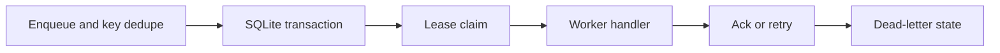

# Architecture and engineering decisions

> **Scope:** a local reference implementation using invented/synthetic inputs. No production deployment or service-level claims are implied.

## SQLite-backed at-least-once jobs

**Actual processing path:** Idempotent enqueue --> BEGIN IMMEDIATE claim --> Lease owner --> Handler execution --> Ack OR delayed retry --> Dead-letter when exhausted.

## Key files

- `queuepilot/queue.py`: transactional job lifecycle, lease ownership and backoff.
- `queuepilot/worker.py`: callable dispatch and failure handling.
- `queuepilot/__main__.py`: local runnable demo.

## Failure modes / trust boundaries

At-least-once is not exactly-once. Workers can be interrupted after effects but before acknowledgement. Persistent storage is local SQLite, not a distributed queue.

## What I would build next

Outbox pattern, jitter, heartbeat renewals, retention, observability, multi-process load tests.

## Reviewer checklist

1. Read the source and confirm the processing path above.
2. Follow `docs/DEMO.md` and run the tests locally.
3. Inspect CI and document any divergence between local and GitHub results.
4. Treat all benchmarks as synthetic demonstrations unless proven otherwise.
